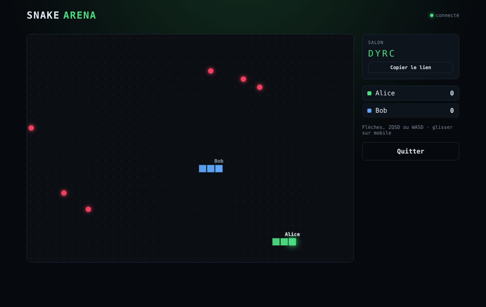

# 🐍Snake Arena

Snake multijoueur en temps réel dans le navigateur. Crée un salon, partage le code (ou le lien) et affronte jusqu'à 8 joueurs.


> 🎮 **[Jouer maintenant](#)** — _ Pas encore deployer, suis les etapes en dessous pour lancer la demo avec npm install et npm run dev _



## Fonctionnalités

- Salons privés avec code à 4 lettres et lien de partage (`?room=ABCD`)
- Jusqu'à 8 joueurs par salon, classement en direct
- Contrôles clavier (flèches, ZQSD, WASD) et glisser sur mobile
- Serveur faisant autorité : impossible de tricher en modifiant le client

## Stack

| Couche | Technologies |
| Front | React 19, Vite, Canvas 2D |
| Back | Node.js, Fastify, Socket.io|
| Partagé | TypeScript strict (`noUncheckedIndexedAccess`) |
| Tests | Vitest (unitaires + intégration avec de vrais sockets) |
| CI | GitHub Actions : typecheck, tests, build |
## Architecture

snake-arena/
├── packages/shared/   # Logique du jeu (pure) + types du protocole réseau
├── apps/server/       # Fastify + Socket.io : salons, boucle de jeu, validation
└── apps/web/          # React : lobby, rendu Canvas, contrôles


 Client (React)                      Serveur (Node)
 ──────────────                      ──────────────
 touche ↓  ── emit('input', 'down') ──▶ validation + rate limit
                                        │
                                        ▼
                                     step(state)   ← toutes les 100 ms
                                        │
 rendu Canvas ◀── emit('state', …) ─────┘  (diffusé à tout le salon)

### Choix techniques

- **Logique partagée et pure.** Les règles du jeu vivent dans `packages/shared` sous forme de fonctions pures `(état) → nouvel état`, sans réseau ni rendu. Elles sont faciles à tester et réutilisables côté client (prédiction, mode solo hors ligne).
- **Le serveur fait autorité.** Les clients n'envoient que des intentions (une direction). Seul le serveur fait avancer la partie, ce qui empêche la triche et garantit que tous les joueurs voient le même état.
- **Protocole typé de bout en bout.** Les événements Socket.io sont décrits une seule fois (`ClientToServerEvents`, `ServerToClientEvents`) et utilisés par le client comme par le serveur : une erreur de protocole est une erreur de compilation.
- **Ne jamais faire confiance au client.** Pseudo, code de salon et direction sont validés côté serveur, et les entrées sont limitées à 20 messages par seconde et par joueur.
- **Collisions simultanées.** Tous les serpents avancent d'abord, puis les collisions sont résolues ensemble : une collision frontale tue les deux joueurs, sans favoriser celui qui est traité en premier.

## Lancer en local

Prérequis : Node.js 20 ou plus.

```bash
npm install
npm run dev
```

Le client tourne sur http://localhost:5173 et le serveur sur http://localhost:3001. Ouvre deux onglets pour jouer à deux.

```bash
npm test          # tous les tests
npm run typecheck # vérification des types
npm run build     # build de production du client
```

### Variables d'environnement

| Variable | Où | Défaut |
| `VITE_SERVER_URL` | client | `http://localhost:3001` |
| `PORT` | serveur | `3001` |
| `CORS_ORIGIN` | serveur | `http://localhost:5173` (plusieurs valeurs séparées par des virgules) |

## Feuille de route

- [x] Logique du jeu testée
- [x] Multijoueur temps réel avec salons
- [x] CI
- [ ] Déploiement (Vercel + Render / Fly.io)
- [ ] Comptes joueurs et classement global (PostgreSQL + Prisma)
- [ ] Prédiction côté client pour masquer la latence
- [ ] Docker Compose
- [ ] Tests de bout en bout (Playwright)

